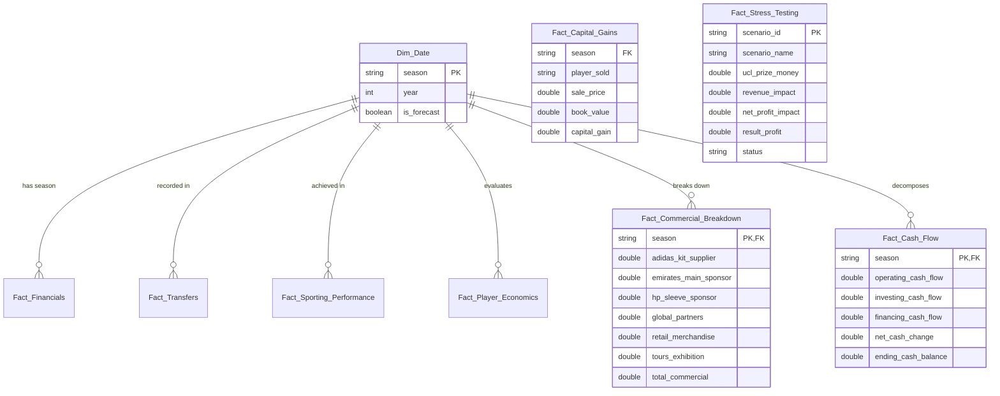

# Data Model Documentation: Real Madrid Analytics

## Expanded Star Schema Architecture

The analytical backend utilizes an enriched **Star Schema** with 5 new institutional data domains:
1. `commercial_breakdown.json` (Kit, Shirt, Sleeve, Global, Retail, Tour sub-segments)
2. `capital_gains.json` (Player sale price, unamortized book value, plusvalías)
3. `cash_flow.json` (Operating, Investing, Financing cash flows)
4. `stress_testing.json` (Downside sporting & macro shocks)
5. `esg_femenino.json` (Women's team economics & ESG sustainability metrics)

